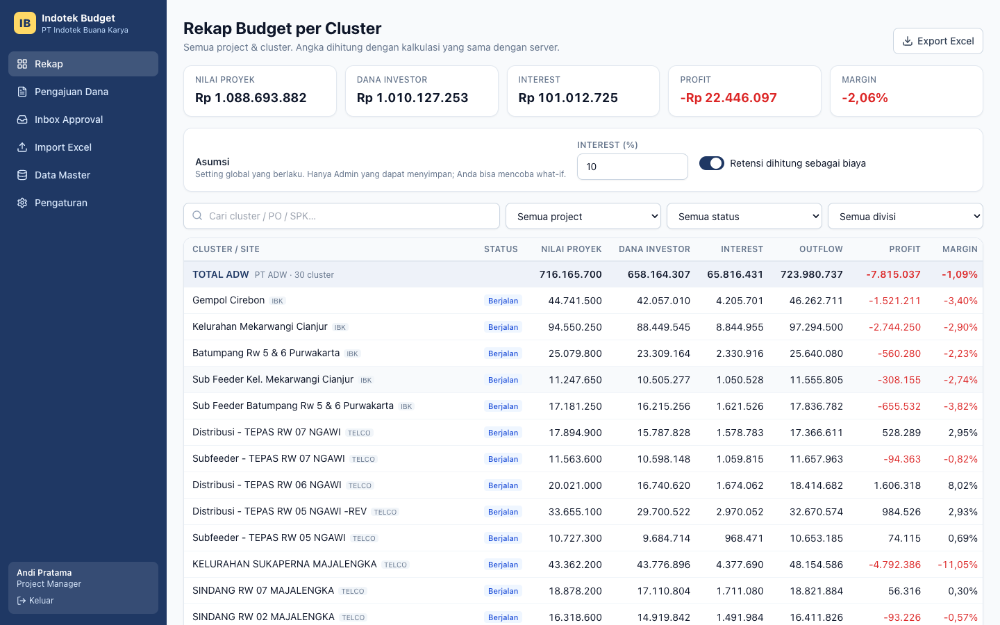
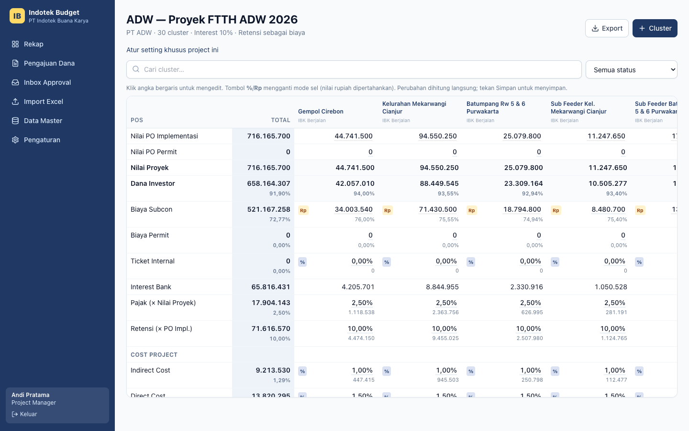
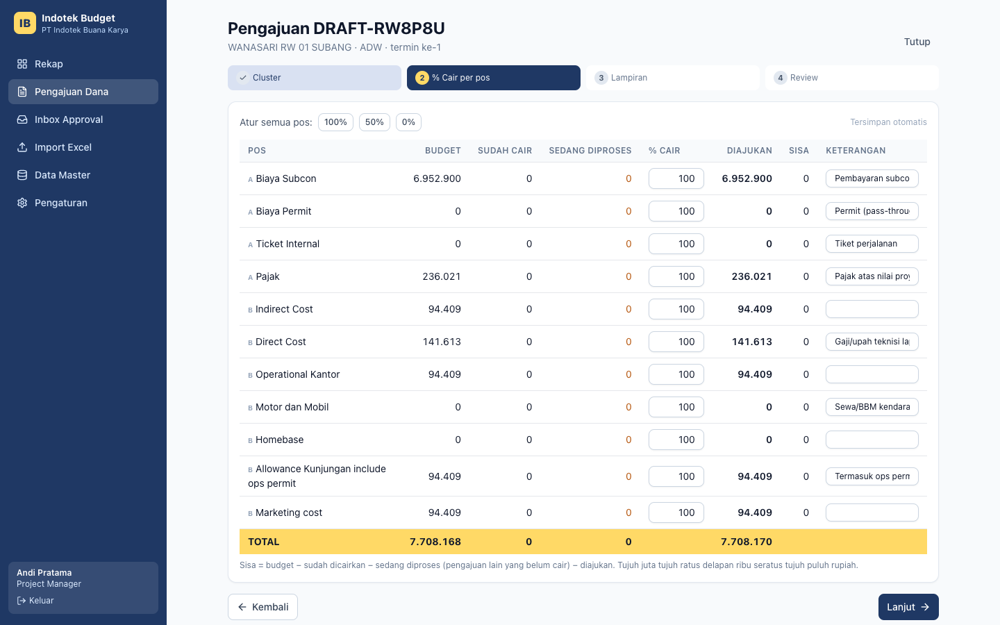
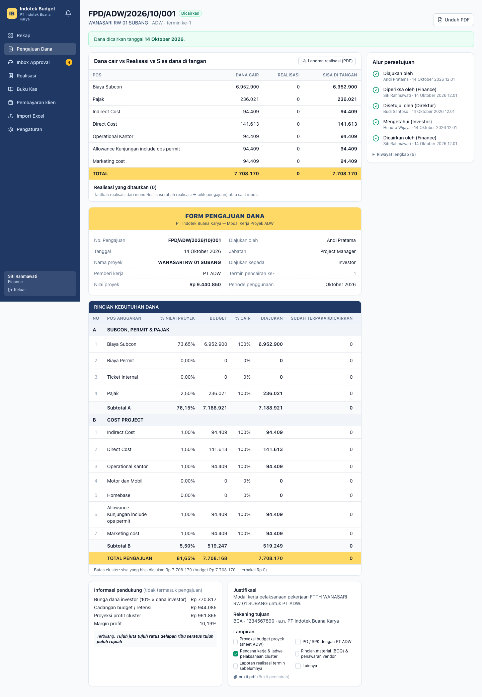
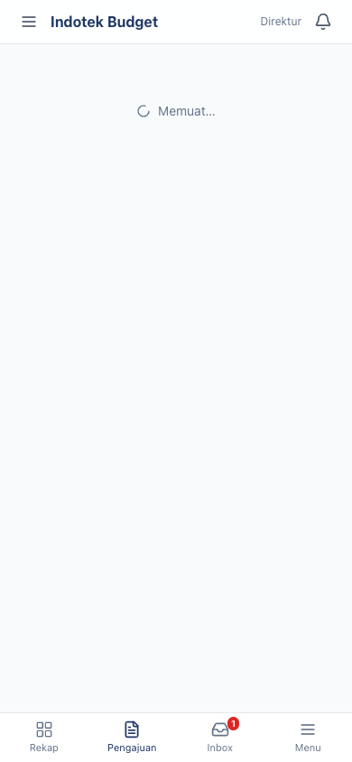
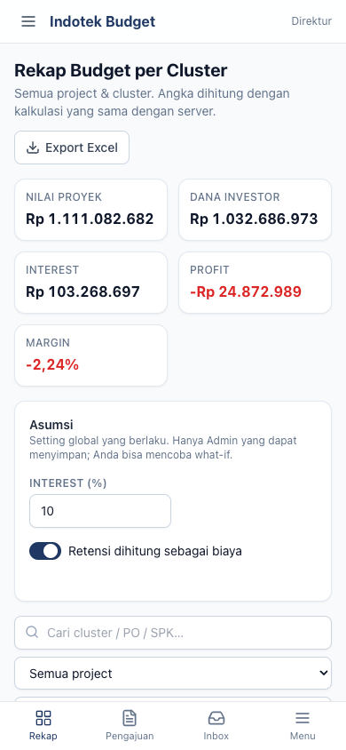

# Indotek Project Budget System

Sistem pengganti Excel manual PT Indotek Buana Karya untuk:

1. proyeksi budget per cluster/site,
2. form pengajuan dana ke investor + approval,
3. realisasi biaya vs budget (fase berikutnya),
4. dashboard & laporan.

Status: **Fase 1** — fondasi, Budget per Cluster, dan Form Pengajuan Dana. Lihat [docs/CHANGELOG.md](docs/CHANGELOG.md).

| Bagian | Teknologi |
|---|---|
| Monorepo | pnpm + Turborepo (`apps/api`, `apps/web`, `packages/shared`) |
| API | NestJS 10, Prisma 5, PostgreSQL 16, JWT (access + refresh), Puppeteer (PDF), exceljs |
| Web | React 18, Vite, Tailwind, TanStack Query/Table, React Hook Form, Zod |
| Kalkulasi | `packages/shared/src/calc` — pure TypeScript + `decimal.js`, dipakai API & web |

## Menjalankan dengan Docker (paling cepat)

```bash
docker compose up --build
```

| Layanan | Alamat |
|---|---|
| Aplikasi web | http://localhost:8080 |
| API | http://localhost:3000/api |
| Swagger | http://localhost:3000/api/docs |
| PostgreSQL | localhost:5432 (user/password `indotek`) |

Saat container API start, ia menjalankan `prisma migrate deploy` lalu seed. Seed membuat:

- user demo,
- setting & template default,
- 3 project,
- cluster dari `docs/samples/Budget_Per_Cluster_ADW_Evantama_CCSI.xlsx`.

Seed bersifat idempotent dan tidak menimpa data yang sudah ada.

## Akun demo

Password semua akun: **`Indotek123!`** (bisa diubah lewat `SEED_PASSWORD`).

| Role | Email | Catatan |
|---|---|---|
| ADMIN | admin@indotek.test | Mengubah setting global, template, akses investor; override sisa budget |
| PM | pm@indotek.test | Edit budget, buat & ajukan pengajuan dana |
| FINANCE | finance@indotek.test | Periksa pengajuan, tandai dicairkan |
| DIREKTUR | direktur@indotek.test | Setujui pengajuan |
| INVESTOR | investor@indotek.test | Hanya project **ADW** (untuk menguji pembatasan akses) |

## Pengembangan lokal

Prasyarat: Node ≥ 22, pnpm 11, Docker (untuk PostgreSQL).

```bash
cp .env.example .env                 # isi JWT_*_SECRET dengan string acak
ln -s ../../.env apps/api/.env       # Prisma CLI membaca .env dari apps/api
docker compose up -d postgres
pnpm install
pnpm --filter @indotek/shared build
(cd apps/api && npx prisma migrate deploy && pnpm seed)
pnpm dev                             # API :3000, web :5173 (proxy /api → :3000)
```

## Perintah

| Perintah | Isi |
|---|---|
| `pnpm test` | Unit test shared (Vitest; termasuk acceptance A–F), test API e2e (Jest + database `indotek_budget_test`), test web (Vitest). Butuh postgres jalan. |
| `pnpm e2e` | Playwright end-to-end. Memakai database `indotek_budget_e2e` sendiri, API :3100, web :5174. Jalankan `npx playwright install chromium` sekali. |
| `pnpm lint` / `pnpm typecheck` | ESLint & TypeScript seluruh workspace |
| `pnpm build` | Build shared, API, web |

## Struktur

```
apps/api/        NestJS — prisma/ (schema, migrasi, seed), src/<modul>, test/ (e2e Jest)
apps/web/        React — src/pages, src/components, src/lib (format, kalkulasi lokal)
packages/shared/ calc/ (budget, pengajuan, terbilang), format/, workflow.ts, schemas/ (Zod), xlsx/ (parser)
e2e/             Playwright
docs/            ACCEPTANCE.md (angka acuan), CHANGELOG.md, samples/, screenshots/
```

## Aturan kalkulasi

- **Rumus:** semua rumus ada di `packages/shared/src/calc/` dan diuji dengan angka acuan di [docs/ACCEPTANCE.md](docs/ACCEPTANCE.md).
- **Uang:** disimpan `Decimal(18,2)`. Persentase disimpan `Decimal(16,12)`.
- **Pembulatan:** perhitungan berjalan dengan presisi penuh, lalu dibulatkan HALF_UP hanya saat disimpan atau ditampilkan.
- **Total project:** dijumlah dari nilai presisi penuh per cluster, lalu dibulatkan.
- **Persentase default:** tidak di-hardcode. Nilainya diambil dari template di DB (menu Pengaturan) dan bisa di-override per project.
- **Audit log:** setiap perubahan angka budget, pengajuan, dan setting tercatat (siapa, kapan, nilai lama → baru) dan bisa dilihat lewat `GET /api/audit`.

## Screenshot

| Rekap | Grid project |
|---|---|
|  |  |

| Wizard — % cair per pos | Detail pengajuan (sudah dicairkan) |
|---|---|
|  |  |

| Approval di HP | Rekap di HP |
|---|---|
|  |  |

Screenshot dibuat otomatis oleh `pnpm e2e`.
