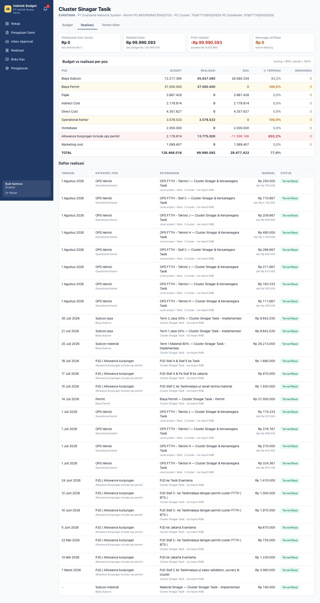
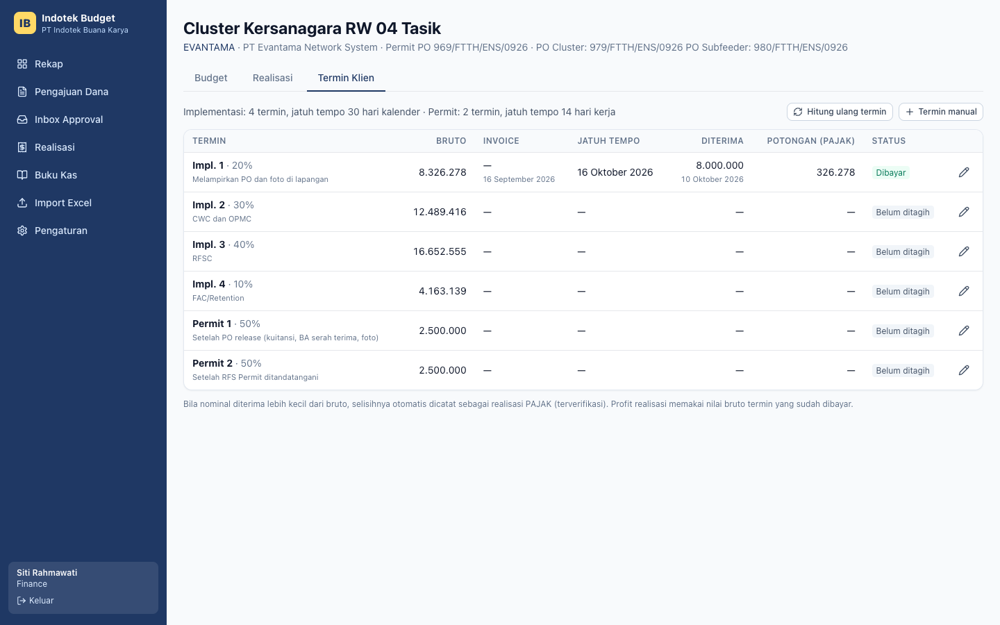
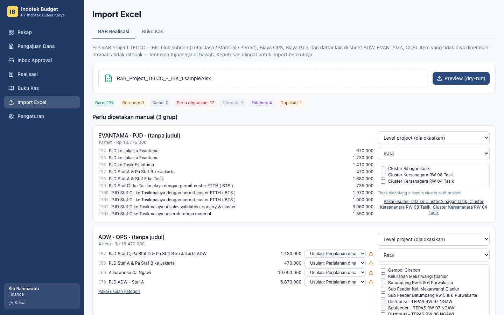
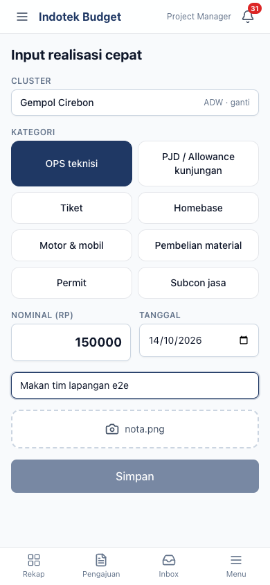

# Indotek Project Budget System

Sistem pengganti Excel manual PT Indotek Buana Karya untuk:

1. proyeksi budget per cluster/site,
2. form pengajuan dana ke investor + approval,
3. realisasi biaya vs budget (fase berikutnya),
4. dashboard & laporan.

Status: **Fase 2** — realisasi biaya vs budget (di atas Fase 1: budget per cluster & pengajuan dana). Lihat [docs/CHANGELOG.md](docs/CHANGELOG.md).

| Bagian | Teknologi |
|---|---|
| Monorepo | pnpm + Turborepo (`apps/api`, `apps/web`, `packages/shared`) |
| API | NestJS 10, Prisma 5, PostgreSQL 16, JWT (access + refresh), Puppeteer (PDF), exceljs |
| Web | React 18, Vite, Tailwind, TanStack Query/Table, React Hook Form, Zod |
| Kalkulasi | `packages/shared/src/calc` — pure TypeScript + `decimal.js`, dipakai API & web |

## Menjalankan dengan Docker (paling cepat)

```bash
docker compose up --build
```

| Layanan | Alamat |
|---|---|
| Aplikasi web | http://localhost:8080 |
| API | http://localhost:3000/api |
| Swagger | http://localhost:3000/api/docs |
| PostgreSQL | localhost:5432 (user/password `indotek`) |

Saat container API start, ia menjalankan `prisma migrate deploy` lalu seed. Seed membuat:

- user demo,
- setting & template default,
- 3 project,
- cluster dari `docs/samples/Budget_Per_Cluster_ADW_Evantama_CCSI.sample.xlsx`.

Seed bersifat idempotent dan tidak menimpa data yang sudah ada.

## Akun demo

Password awal semua akun: **`Indotek123!`** (bisa diubah lewat `SEED_PASSWORD`). Saat login pertama, setiap akun **wajib mengganti password** (minimal 10 karakter, berisi huruf dan angka).

User demo hanya dibuat bila `NODE_ENV` bukan `production`. Di production, seed hanya membuat master data dan admin awal dari `INITIAL_ADMIN_EMAIL` / `INITIAL_ADMIN_PASSWORD`. Cluster contoh tidak diimpor kecuali `SEED_SAMPLE_CLUSTERS=true`.

| Role | Email | Catatan |
|---|---|---|
| ADMIN | admin@indotek.test | Mengubah setting global & setting project, template, akses investor; override sisa budget |
| PM | pm@indotek.test | Edit budget, buat & ajukan pengajuan dana |
| FINANCE | finance@indotek.test | Periksa pengajuan, tandai dicairkan |
| DIREKTUR | direktur@indotek.test | Setujui pengajuan; ubah setting khusus project |
| INVESTOR | investor@indotek.test | Hanya project **ADW** (untuk menguji pembatasan akses) |

## Uji dari HP lewat LAN (HTTPS)

Cookie sesi bertanda `Secure`, jadi akses dari HP lewat IP LAN butuh HTTPS. Untuk itu tersedia service Caddy opsional dengan TLS internal:

```bash
LAN_HOST=192.168.1.20 TRUST_PROXY_HOPS=2 docker compose --profile https up -d --build
# buka https://192.168.1.20:8443 di HP (satu jaringan Wi-Fi dengan laptop)
```

- **`LAN_HOST`:** IP laptop di jaringan lokal (cek dengan `ipconfig getifaddr en0` di macOS).
- **`TRUST_PROXY_HOPS=2`:** wajib di-set karena request melewati Caddy lalu nginx, agar IP klien untuk rate limit login terbaca benar.
- **Peringatan sertifikat di HP:** sertifikat dibuat oleh CA lokal Caddy, jadi HP akan menampilkan peringatan. Pilihan:
  - lanjutkan saja (khusus pengujian), atau
  - pasang root CA di HP. File-nya ada di volume `caddy_data`, diambil dengan `docker compose cp caddy:/data/caddy/pki/authorities/local/root.crt ./caddy-root.crt`.
- **Tanpa profile `https`:** stack biasa tetap jalan di `http://localhost:8080`.

## Realisasi (Fase 2)

- **Pencatatan:** realisasi dicatat sebagai *expense* per cluster, atau level project yang dialokasikan ke beberapa cluster (rata / pro-rata nilai PO implementasi / manual).
  - Angka per cluster selalu dibaca dari alokasi.
  - Sisa pembulatan masuk ke cluster terakhir.
- **Verifikasi:** hanya expense **terverifikasi** yang dihitung.
  - Input PM (termasuk input cepat HP) dan kiriman bot berstatus "Perlu verifikasi" sampai diverifikasi FINANCE.
  - Input FINANCE/ADMIN langsung terverifikasi.
- **Termin klien:**
  - Dibuat otomatis dari template client: ADW 80/10/10; Evantama implementasi 20/30/40/10 (30 hari kalender) dan permit 50/50 (14 hari kerja). CCSI masih diinput manual.
  - Jatuh tempo hari kerja melewati Sabtu, Minggu, dan tabel Hari Libur.
  - Bila nominal diterima < bruto, selisihnya otomatis menjadi expense PAJAK.
- **Import Excel** (menu Import → RAB Realisasi / Buku Kas): dry-run → preview → keputusan pemetaan manual (diingat untuk import berikutnya) → commit. Buku kas hanya untuk referensi dan rekonsiliasi.
- **Import dari CLI:** dengan aturan pemetaan default (mis. di container Docker):
  `docker compose exec api npx ts-node --transpile-only scripts/import-rab.ts /app/docs/samples/RAB_Project_TELCO_-_IBK_1.sample.xlsx [--dry-run]`.
  Script mencetak laporan per project: total realisasi, jumlah item terimpor/dilewati/ditahan/duplikat, dan 5 cluster dengan % terpakai tertinggi.
- **Item "Ditahan — perlu konfirmasi":** dilepas atau ditandai lewati/duplikat di menu Import → RAB Realisasi, tanpa unggah ulang.
- **Webhook bot (Telegram/n8n):** `POST /api/webhooks/expenses` dengan header `X-API-Key` (dibuat ADMIN di Pengaturan → API key).

```bash
curl -X POST https://<host>/api/webhooks/expenses \
  -H "X-API-Key: ibk_xxxx_..." -H "Content-Type: application/json" \
  -d '{"cluster":"Gempol Cirebon","kategori":"OPS","nominal":150000,"tanggal":"2026-10-14",
       "keterangan":"Makan tim","externalId":"tg-123","fotoBase64":"data:image/jpeg;base64,..."}'
# atau multipart: field yang sama + file "foto"
```

`kategori` boleh berupa kode (`OPS`, `PJD`, `TICKET`, `HOMEBASE`, `MOTOR_MOBIL`, `MATERIAL_PEMBELIAN`, `PERMIT`, `SUBCON_JASA`, …) atau labelnya. `cluster` boleh berupa id atau nama persis. Kiriman ulang dengan `externalId` yang sama tidak membuat data dobel.

## Keamanan sesi

- **Penyimpanan token:** access token dan refresh token disimpan di cookie `HttpOnly; Secure; SameSite=Lax`, tidak pernah di `localStorage`.
- **CSRF:** request yang mengubah data wajib membawa header `X-CSRF-Token` yang sama dengan cookie `csrf_token` (double-submit).
- **Rate limit login:** maksimal 5 percobaan per menit per kombinasi IP + email.
- **Akses lewat HTTP:** browser modern menerima cookie `Secure` di `http://localhost`. Untuk akses HTTP dari host lain (mis. IP LAN saat uji coba di HP), set `COOKIE_SECURE=false`. Jangan lakukan ini di production; gunakan HTTPS.

## File contoh

- **Isi folder `docs/samples/`:** file `*.sample.xlsx` yang sudah disanitasi. Nama orang, nomor rekening, komentar, metadata penulis, dan ID Google Sheet sudah diganti, sementara angka tetap sama.
- **File asli:** disimpan di `private/`, yang masuk `.gitignore` dan tidak pernah di-commit.

## Pengembangan lokal

Prasyarat: Node ≥ 22, pnpm 11, Docker (untuk PostgreSQL).

```bash
cp .env.example .env                 # isi JWT_*_SECRET dengan string acak
ln -s ../../.env apps/api/.env       # Prisma CLI membaca .env dari apps/api
docker compose up -d postgres
pnpm install
pnpm --filter @indotek/shared build
(cd apps/api && npx prisma migrate deploy && pnpm seed)
pnpm dev                             # API :3000, web :5173 (proxy /api → :3000)
```

## Perintah

| Perintah | Isi |
|---|---|
| `pnpm test` | Unit test shared (Vitest; termasuk acceptance A–F), test API e2e (Jest + database `indotek_budget_test`), test web (Vitest). Butuh postgres jalan. |
| `pnpm e2e` | Playwright end-to-end. Memakai database `indotek_budget_e2e` sendiri, API :3100, web :5174. Jalankan `npx playwright install chromium` sekali. |
| `pnpm lint` / `pnpm typecheck` | ESLint & TypeScript seluruh workspace |
| `pnpm build` | Build shared, API, web |

## Struktur

```
apps/api/        NestJS — prisma/ (schema, migrasi, seed), src/<modul>, test/ (e2e Jest)
apps/web/        React — src/pages, src/components, src/lib (format, kalkulasi lokal)
packages/shared/ calc/ (budget, pengajuan, terbilang), format/, workflow.ts, schemas/ (Zod), xlsx/ (parser)
e2e/             Playwright
docs/            ACCEPTANCE.md (angka acuan), CHANGELOG.md, samples/, screenshots/
```

## Aturan kalkulasi

- **Rumus:** semua rumus ada di `packages/shared/src/calc/` dan diuji dengan angka acuan di [docs/ACCEPTANCE.md](docs/ACCEPTANCE.md).
- **Uang:** disimpan `Decimal(18,2)`. Persentase disimpan `Decimal(16,12)`.
- **Pembulatan:** perhitungan berjalan dengan presisi penuh, lalu dibulatkan HALF_UP hanya saat disimpan atau ditampilkan.
- **Total project:** dijumlah dari nilai presisi penuh per cluster, lalu dibulatkan.
- **Persentase default:** tidak di-hardcode. Nilainya diambil dari template di DB (menu Pengaturan) dan bisa di-override per project.
- **Audit log:** setiap perubahan angka budget, pengajuan, dan setting tercatat (siapa, kapan, nilai lama → baru) dan bisa dilihat lewat `GET /api/audit`.

## Screenshot

| Rekap | Grid project |
|---|---|
|  |  |

| Realisasi cluster | Termin klien |
|---|---|
|  |  |

| Import RAB (pemetaan manual) | Input cepat di HP |
|---|---|
|  |  |

| Wizard — % cair per pos | Detail pengajuan (sudah dicairkan) |
|---|---|
|  |  |

| Approval di HP | Rekap di HP |
|---|---|
|  |  |

Screenshot dibuat otomatis oleh `pnpm e2e`.
